# LAZARUS-X — Formal Entity Relationship (ER) Diagram

> **System**: LAZARUS-X Forensic Relational Database Reconstruction  
> **Course**: BCSE302P — Database Management Systems  
> **Architecture**: 11 Normalized Relational Entities (3NF / BCNF)  
> **Target Engine**: PostgreSQL 15 / SQLite 3 via Prisma ORM  

---

## 1. Complete Entity-Relationship (ER) Diagram

```mermaid
erDiagram
    USER ||--o{ SESSION : maintains
    USER ||--o{ RECONSTRUCTION_CASE : owns
    USER ||--o{ AUDIT_LOG : generates
    USER ||--o{ EVIDENCE_FRAGMENT : submits

    USER {
        string id PK "UUID"
        string email UK "Unique Email"
        string passwordHash "BCrypt Cost 12 Hash"
        string role "ADMIN | INVESTIGATOR"
        datetime createdAt "Default NOW"
    }

    SESSION {
        string id PK "UUID"
        string token UK "SHA-256 Token Digest"
        string userId FK "References USER.id (ON DELETE CASCADE)"
        datetime expiresAt "Session Expiry (24h TTL)"
        datetime createdAt "Default NOW"
    }

    AUDIT_LOG {
        string id PK "UUID"
        string userId FK "References USER.id"
        string action "Event Action (LOGIN, CREATE_CASE, etc.)"
        string resourceType "CASE | EVIDENCE | USER"
        string resourceId "Target Entity ID"
        datetime timestamp "Default NOW"
    }

    RECONSTRUCTION_CASE ||--o{ EVIDENCE_FRAGMENT : collects
    RECONSTRUCTION_CASE ||--o{ EVIDENCE_PROVENANCE_ENTRY : records
    RECONSTRUCTION_CASE ||--o{ CANDIDATE_RECONSTRUCTION : branches
    RECONSTRUCTION_CASE ||--o{ CONSTRAINT_EVALUATION : audits

    RECONSTRUCTION_CASE {
        string id PK "UUID"
        string name "Case Title"
        string status "ACTIVE | SEALED | RESOLVED"
        string currentState "JSON Snapshot of Top Candidate"
        string provenanceHead "Current SHA-256 Chain Hash"
        int provenanceSequence "Monotonic Event Counter"
        string provenanceSaltCiphertext "AES-256-GCM Case Salt"
        string ownerId FK "References USER.id"
        datetime createdAt "Default NOW"
        datetime updatedAt "Auto Updated"
    }

    EVIDENCE_FRAGMENT {
        string id PK "UUID"
        string caseId FK "References RECONSTRUCTION_CASE.id (CASCADE)"
        string table "Target Domain Table Name"
        int recordId "Record Primary Key"
        string field "Target Column Attribute"
        string value "Observed Scalar Value"
        string userId FK "References USER.id"
        datetime timestamp "Default NOW"
    }

    EVIDENCE_PROVENANCE_ENTRY {
        string id PK "UUID"
        string caseId FK "References RECONSTRUCTION_CASE.id (CASCADE)"
        int sequence "Monotonic Per-Case Counter"
        string eventType "EVIDENCE_ACCEPTED | FUZZY_CORRECTION"
        string fragmentId "Source Fragment UUID"
        string relatedFragmentIds "Canonical JSON String Array"
        string actorId "HMAC Masked Investigator ID"
        datetime receivedAt "Receipt Timestamp"
        payload string "Canonical JSON Payload"
        string previousHash "Parent Entry SHA-256 Hash"
        string hash "Entry SHA-256 Commitment Hash"
    }

    CANDIDATE_RECONSTRUCTION {
        string id PK "UUID"
        string caseId FK "References RECONSTRUCTION_CASE.id (CASCADE)"
        string stateDump "JSON Database State Dump"
        float probabilityScore "Normalized Heuristic Probability"
        boolean isPruned "Branch Pruning Status"
        datetime createdAt "Default NOW"
    }

    CONSTRAINT_EVALUATION {
        string id PK "UUID"
        string caseId FK "References RECONSTRUCTION_CASE.id (CASCADE)"
        string constraintId "AC-3 Constraint Identifier"
        int fatalViolations "Fatal Collision Count"
        int resolvableViolations "Missing Parent Dependency Count"
        datetime evaluatedAt "Default NOW"
    }

    DEPARTMENT ||--o{ EMPLOYEE : employs
    DEPARTMENT {
        int id PK "Autoincrement"
        string name "Department Name"
    }

    EMPLOYEE ||--o{ ORDER : processes
    EMPLOYEE {
        int id PK "Autoincrement"
        string name "Employee Name"
        int departmentId FK "References DEPARTMENT.id"
    }

    ORDER {
        int id PK "Autoincrement"
        float amount "Transaction Order Total"
        int employeeId FK "References EMPLOYEE.id"
    }
```

---

## 2. Cardinality & Relationship Specification

| Relationship | Cardinality | Parent Entity | Child Entity | Foreign Key Column | Cascade Action |
| :--- | :---: | :--- | :--- | :--- | :--- |
| **User Maintains Sessions** | 1 : N | `User` | `Session` | `Session.userId` | `ON DELETE CASCADE` |
| **User Owns Cases** | 1 : N | `User` | `ReconstructionCase` | `ReconstructionCase.ownerId` | `RESTRICT` |
| **User Generates Audit Logs** | 1 : N | `User` | `AuditLog` | `AuditLog.userId` | `RESTRICT` |
| **User Submits Evidence** | 1 : N | `User` | `EvidenceFragment` | `EvidenceFragment.userId` | `RESTRICT` |
| **Case Collects Fragments** | 1 : N | `ReconstructionCase` | `EvidenceFragment` | `EvidenceFragment.caseId` | `ON DELETE CASCADE` |
| **Case Records Provenance** | 1 : N | `ReconstructionCase` | `EvidenceProvenanceEntry` | `EvidenceProvenanceEntry.caseId` | `ON DELETE CASCADE` |
| **Case Branches Candidates** | 1 : N | `ReconstructionCase` | `CandidateReconstruction` | `CandidateReconstruction.caseId` | `ON DELETE CASCADE` |
| **Case Audits Constraints** | 1 : N | `ReconstructionCase` | `ConstraintEvaluation` | `ConstraintEvaluation.caseId` | `ON DELETE CASCADE` |
| **Department Employs Staff** | 1 : N | `Department` | `Employee` | `Employee.departmentId` | `RESTRICT` |
| **Employee Processes Orders** | 1 : N | `Employee` | `Order` | `Order.employeeId` | `RESTRICT` |

---

## 3. Relational Schema (Formal Relational Notation)

1. **User** (<u>id</u>, email, passwordHash, role, createdAt)  
   *Candidate Key*: `id`, `email`

2. **Session** (<u>id</u>, token, userId &rarr; User.id, expiresAt, createdAt)  
   *Candidate Key*: `id`, `token`

3. **AuditLog** (<u>id</u>, userId &rarr; User.id, action, resourceType, resourceId, timestamp)  
   *Candidate Key*: `id`

4. **ReconstructionCase** (<u>id</u>, name, status, currentState, provenanceHead, provenanceSequence, provenanceSaltCiphertext, ownerId &rarr; User.id, createdAt, updatedAt)  
   *Candidate Key*: `id`  
   *Index*: `(ownerId, updatedAt)`

5. **EvidenceFragment** (<u>id</u>, caseId &rarr; ReconstructionCase.id, table, recordId, field, value, userId &rarr; User.id, timestamp)  
   *Candidate Key*: `id`  
   *Index*: `(caseId, id)`

6. **EvidenceProvenanceEntry** (<u>id</u>, caseId &rarr; ReconstructionCase.id, sequence, eventType, fragmentId, relatedFragmentIds, actorId, receivedAt, payload, previousHash, hash)  
   *Candidate Key*: `id`, `(caseId, sequence)`  
   *Indexes*: `(caseId, hash)`, `(caseId, receivedAt)`

7. **CandidateReconstruction** (<u>id</u>, caseId &rarr; ReconstructionCase.id, stateDump, probabilityScore, isPruned, createdAt)  
   *Candidate Key*: `id`

8. **ConstraintEvaluation** (<u>id</u>, caseId &rarr; ReconstructionCase.id, constraintId, fatalViolations, resolvableViolations, evaluatedAt)  
   *Candidate Key*: `id`

9. **Department** (<u>id</u>, name)  
   *Candidate Key*: `id`

10. **Employee** (<u>id</u>, name, departmentId &rarr; Department.id)  
    *Candidate Key*: `id`

11. **Order** (<u>id</u>, amount, employeeId &rarr; Employee.id)  
    *Candidate Key*: `id`

---

## 4. Normalization Verification (3NF & BCNF)

- **1NF (First Normal Form)**: All column values are atomic scalars. Multi-attribute structures (e.g. state dumps, JSON manifests) are stored as serialized atomic strings/JSON payloads with dedicated foreign key relations.
- **2NF (Second Normal Form)**: The schema is in 1NF and contains zero partial key dependencies; every non-prime attribute is fully functionally dependent on the entire primary key of its relation.
- **3NF (Third Normal Form)**: The schema is in 2NF and exhibits zero transitive dependencies. Foreign attributes directly link to their parent entity's primary key (`X -> Y` where `X` is a superkey).
- **BCNF (Boyce-Codd Normal Form)**: For every non-trivial functional dependency `X -> A`, `X` is a superkey of the table.
