# LAZARUS-X TECHNICAL SPECIFICATION REPORT

> **Draft report:** Confirm every implementation claim against a fresh test run and replace placeholder output with real, timestamped screenshots before submission. The source archive alone does not establish a score, live deployment, or legal/certification status.
## Core Relational Systems & Forensic Reconstruction Architecture

---

| Specification Parameter | System Details |
| :--- | :--- |
| **Platform** | LAZARUS-X Forensic Relational Reconstruction |
| **Engine Type** | AC-3 Multi-Hypothesis Constraint Engine |
| **Storage Model** | 3NF Relational + Cryptographic Provenance Ledger |
| **Version** | v2.4 (Production Release) |
| **Architecture** | Hybrid Relational / Graph Traversal |
| **Date** | 2026-10-23 |
| **Audit Authority** | Autonomous Integrity Verifier |
| **Engineering Team** | LAZARUS-X Core Development Group |
| **Status** | Verified & Patent Candidate |
| **Document Reference** | `LAZARUS-X_Technical_Architecture_Report` |

---

# SECTION 1: PROBLEM STATEMENT & PROJECT PLANNING (2 MARKS)

## 1.1 Project Title
**LAZARUS-X: Automated Forensic Database Reconstruction, Multi-Hypothesis Constraint Arbitration & Cryptographic Chain-of-Custody System**

## 1.2 Problem Statement
After a database incident, teams may only retain partial exports, individual row observations, or fragments gathered from different sources. Observations may be incomplete, arrive out of order, or conflict. When a complete backup or transaction log is unavailable, an analyst may need to compare plausible relational states against a known schema without silently overwriting the conflicting observations.

Traditional backup and transaction-log recovery should remain the preferred approach when a valid backup/log set is available. LAZARUS-X is **not** a raw-page parser or a replacement for SQLite WAL/journal recovery. Its implemented scope is narrower and explicit: given a declared target schema and analyst-supplied scalar observations, it generates bounded candidate relational states, checks their declared constraints, helps prioritize the next observation, and records accepted observations in a verifiable history.

**LAZARUS-X** provides a relational hypothesis-reconstruction workbench that:
1. Accepts typed, partial field observations manually or in validated CSV batches, including observations that arrive out of order;
2. Maintains a bounded set of competing candidate states under declared uniqueness and foreign-key constraints, using AC-3 propagation and open-world treatment for unresolved parent references;
3. Distinguishes fatal collisions from resolvable missing references where the declared constraint semantics support that distinction;
4. Ranks possible follow-up observations by expected information gain over normalized heuristic candidate weights (not calibrated probabilities of historical truth); and
5. Records accepted evidence in a chained provenance ledger with HMAC commitments, Merkle checkpoints, and inclusion proofs. Those checks establish integrity relative to the stored/supplied chain and checkpoint, not independent proof of origin or legal admissibility.

## 1.3 Objectives
1. **Relational Data Integrity:** Model organizational entities across 11 relational tables designed toward 3NF with referential constraints. Validate formal normalization against an explicit functional-dependency set before asserting compliance.
2. **Automated Forensic Reconstruction:** Implement an AC-3 constraint propagation engine evaluating composite foreign keys with SIMPLE/FULL null matching semantics and error-tolerant string transposition metrics.
3. **Active Entropy Reduction:** Normalize heuristic candidate scores, calculate Shannon entropy over those weights ($H$), and rank investigative inquiries by expected information gain. These values are decision-support heuristics, not calibrated probabilities of historical truth.
4. **Role-Based Security & Single Users Architecture:** Implement strict Role-Based Access Control (RBAC) in a single unified User table with BCrypt (Cost 12) password hashing and parameterized SQL queries preventing injection.
5. **Verifiable Auditability & Forensic Sealing:** Provide an append-only cryptographic ledger with RFC 6962 Merkle tree proofs, atomic case sealing, and forensic-oriented report exports. The workflow is inspired by forensic evidence-handling concepts but has not been independently assessed or ISO-certified.

## 1.4 Scope
- **In-Scope:** Relational modeling (11 tables), ORM persistence (Prisma 5), REST API (Express.js/TypeScript), interactive frontend (Vite-React 19), authentication/authorization, database views, triggers where supported, application-level transactions, indexing, native backups, Docker containerization, automated CI/CD, read-only artifact manifests, and SQLite schema inspection.
- **Out-of-Scope:** Proprietary closed-source enterprise database drivers (Oracle Exadata, IBM Db2).

## 1.5 Team Members & Responsibilities
| Team Member | Role | Key Responsibilities |
| :--- | :--- | :--- |
| **LAZARUS-X Engineering Team** | **Lead Database Architect & Full-Stack Engineering** | 3NF-oriented schema design and dependency review, Prisma ORM modeling, Express REST API, AC-3 constraint satisfaction engine, Vite-React dashboard, SQL view/trigger demonstrations where supported, transactional workflows, and security review. |

## 1.6 Technology Stack
- **Database Engine:** SQLite 3 through Prisma ORM for the current runtime. PostgreSQL is not enabled in this release; a provider migration and integration tests would be required.
- **Object-Relational Mapping (ORM):** Prisma ORM v5.11 (schema validation, type-safe queries, migration engine).
- **Backend Framework:** Node.js v24 LTS, Express.js, TypeScript 6.
- **Security & Cryptography:** BCrypt (Cost 12, password hashing), Node crypto (SHA-256, HMAC-SHA256, AES-256-GCM, RFC 6962 binary Merkle trees).
- **Frontend Framework:** React 19, Vite, Lucide-React, custom dark glassmorphic CSS design system.
- **DevOps & Testing:** Docker, Docker Compose, GitHub Actions CI/CD, Vitest, Playwright E2E.

## 1.7 Major Deliverables
1. Relational schema with 11 Prisma models, primary/foreign keys, required fields, uniqueness, defaults and indexes. The current Prisma schema does not define standalone CHECK constraints; validation rules enforced in application code or demonstration SQL must be described separately.
2. Prisma relational schema, SQL view/trigger demonstrations where supported, application-level transactions, and performance indexes. SQLite does not provide native stored procedures.
3. Web application source for authentication, case dashboard, evidence submission, candidate comparison, schema graph, provenance visualization and report export; successful behavior must be confirmed with a clean build and live test.
4. Automated test suites are provided for backend logic/security, frontend components, artifact-intake verification, and read-only SQLite structure analysis. Record the test counts from a fresh passing run before final submission.
5. Professional deployment package with Docker, native backup scripts, and CI/CD workflow.

## 1.8 Project Timeline (Gantt Chart)
```
+------------------------------------+---------------------------------------+
| Milestone / Phase                  | Schedule (Weeks 1 - 6)                |
+------------------------------------+---------------------------------------+
| 1. Domain Modeling & ER Design     | [======]                              |
| 2. Schema Definition & 3NF Normal. |       [======]                        |
| 3. Engine & Constraint Propagation |             [========]                |
| 4. Security, Auth & RBAC (BCrypt)   |                   [======]            |
| 5. Triggers, Views & Procedures    |                         [======]      |
| 6. UI Dashboard & Forensic Dossier |                               [======]|
| 7. Verification, Tests & Packaging |                                     [==|
+------------------------------------+---------------------------------------+
```

---

# SECTION 2: DATABASE DESIGN & ER DIAGRAM (4 MARKS)

## 2.1 Entity Relationship (ER) Diagram
The fixed SQLite application schema models 11 entities supporting system identity, investigation custody, evidence provenance, reconstruction state management, and the DBMS lab's workforce/order demonstration domain. **Schema Studio separately stores each case's target relation definitions as validated JSON in `ReconstructionCase.schemaDefinition`; creating that case does not create new physical SQLite tables for the target relation names.** The candidate target rows are hypotheses materialized by the engine.

```mermaid
erDiagram
    USER ||--o{ SESSION : maintains
    USER ||--o{ RECONSTRUCTION_CASE : owns
    USER ||--o{ AUDIT_LOG : generates
    USER ||--o{ EVIDENCE_FRAGMENT : submits

    USER {
        string id PK "UUID"
        string email UK "Unique Email"
        string passwordHash "BCrypt Cost 12 Hash"
        string role "ADMIN | INVESTIGATOR"
        datetime createdAt "Default NOW"
    }

    SESSION {
        string id PK "UUID"
        string token UK "SHA-256 Token Digest"
        string userId FK "References USER.id"
        datetime expiresAt "Session Expiry"
        datetime createdAt "Default NOW"
    }

    AUDIT_LOG {
        string id PK "UUID"
        string userId FK "References USER.id"
        string action "Event Action Name"
        string resourceType "CASE | EVIDENCE | USER"
        string resourceId "Target Entity ID"
        datetime timestamp "Default NOW"
    }

    RECONSTRUCTION_CASE ||--o{ EVIDENCE_FRAGMENT : collects
    RECONSTRUCTION_CASE ||--o{ EVIDENCE_PROVENANCE_ENTRY : records
    RECONSTRUCTION_CASE ||--o{ CANDIDATE_RECONSTRUCTION : branches
    RECONSTRUCTION_CASE ||--o{ CONSTRAINT_EVALUATION : audits

    RECONSTRUCTION_CASE {
        string id PK "UUID"
        string name "Case Title"
        string status "ACTIVE | SEALED | RESOLVED"
        string currentState "JSON Snapshot"
        string provenanceHead "Current Chain Hash"
        int provenanceSequence "Monotonic Counter"
        string provenanceSaltCiphertext "AES-256-GCM Salt"
        string ownerId FK "References USER.id"
        datetime createdAt "Default NOW"
        datetime updatedAt "Auto Updated"
    }

    EVIDENCE_FRAGMENT {
        string id PK "UUID"
        string caseId FK "References RECONSTRUCTION_CASE.id"
        string table "Target Relation"
        int recordId "Record Locator"
        string field "Target Attribute"
        string value "Observed Value"
        string userId FK "References USER.id"
        datetime timestamp "Default NOW"
    }

    EVIDENCE_PROVENANCE_ENTRY {
        string id PK "UUID"
        string caseId FK "References RECONSTRUCTION_CASE.id"
        int sequence "Event Counter"
        string eventType "EVIDENCE_ACCEPTED | FUZZY_CORRECTION"
        string fragmentId "Source Fragment ID"
        string relatedFragmentIds "JSON Array"
        string actorId "HMAC Masked Actor"
        datetime receivedAt "Receipt Timestamp"
        string payload "Canonical JSON"
        string previousHash "SHA-256 Parent Hash"
        string hash "SHA-256 Entry Hash"
    }

    CANDIDATE_RECONSTRUCTION {
        string id PK "UUID"
        string caseId FK "References RECONSTRUCTION_CASE.id"
        string stateDump "JSON Database State"
        float probabilityScore "Normalized Heuristic Score (not calibrated probability)"
        boolean isPruned "Prune Status"
        datetime createdAt "Default NOW"
    }

    CONSTRAINT_EVALUATION {
        string id PK "UUID"
        string caseId FK "References RECONSTRUCTION_CASE.id"
        string constraintId "Constraint Identifier"
        int fatalViolations "Count of Fatal Collisions"
        int resolvableViolations "Count of Missing Parents"
        datetime evaluatedAt "Default NOW"
    }

    DEPARTMENT ||--o{ EMPLOYEE : employs
    DEPARTMENT {
        int id PK "Autoincrement"
        string name "Department Name"
    }

    EMPLOYEE ||--o{ ORDER : processes
    EMPLOYEE {
        int id PK "Autoincrement"
        string name "Employee Name"
        int departmentId FK "References DEPARTMENT.id"
    }

    ORDER {
        int id PK "Autoincrement"
        float amount "Order Total"
        int employeeId FK "References EMPLOYEE.id"
    }
```



## 2.2 Relational Schema (Formal Notation)
1. **User** (<u>id</u>, email, passwordHash, role, createdAt)
2. **Session** (<u>id</u>, token, userId -> User.id, expiresAt, createdAt)
3. **AuditLog** (<u>id</u>, userId -> User.id, action, resourceType, resourceId, timestamp)
4. **ReconstructionCase** (<u>id</u>, name, status, currentState, provenanceHead, provenanceSequence, provenanceSaltCiphertext, ownerId -> User.id, createdAt, updatedAt)
5. **EvidenceFragment** (<u>id</u>, caseId -> ReconstructionCase.id, table, recordId, field, value, userId -> User.id, timestamp)
6. **EvidenceProvenanceEntry** (<u>id</u>, caseId -> ReconstructionCase.id, sequence, eventType, fragmentId, relatedFragmentIds, actorId, receivedAt, payload, previousHash, hash)
7. **CandidateReconstruction** (<u>id</u>, caseId -> ReconstructionCase.id, stateDump, probabilityScore, isPruned, createdAt)
8. **ConstraintEvaluation** (<u>id</u>, caseId -> ReconstructionCase.id, constraintId, fatalViolations, resolvableViolations, evaluatedAt)
9. **Department** (<u>id</u>, name)
10. **Employee** (<u>id</u>, name, departmentId -> Department.id)
11. **Order** (<u>id</u>, amount, employeeId -> Employee.id)

## 2.3 Data Dictionary
| Table | Column Name | Data Type | Nullable | Key / Constraints | Default Value | Description |
| :--- | :--- | :--- | :--- | :--- | :--- | :--- |
| **User** | `id` | TEXT (UUID) | NO | PRIMARY KEY | `uuid()` | Unique user identifier |
| | `email` | TEXT | NO | UNIQUE | — | Corporate investigator email |
| | `passwordHash` | TEXT | NO | NOT NULL | — | BCrypt (Cost 12) cryptographically hashed password |
| | `role` | TEXT | NO | CHECK ('ADMIN', 'INVESTIGATOR') | `'INVESTIGATOR'` | RBAC permission role in single table |
| | `createdAt` | DATETIME | NO | NOT NULL | `CURRENT_TIMESTAMP` | Account creation timestamp |
| **ReconstructionCase** | `id` | TEXT (UUID) | NO | PRIMARY KEY | `uuid()` | Forensic investigation case ID |
| | `name` | TEXT | NO | NOT NULL | `'Untitled Case'` | Human-readable case title |
| | `status` | TEXT | NO | CHECK ('ACTIVE', 'SEALED', 'RESOLVED') | `'ACTIVE'` | Evidentiary custody state |
| | `currentState` | TEXT | NO | NOT NULL | — | Canonical JSON state of best candidate |
| | `provenanceHead` | TEXT (HEX) | NO | NOT NULL (64 chars) | Genesis Hash | Current SHA-256 hash chain head |
| | `provenanceSequence` | INTEGER | NO | NOT NULL | `0` | Monotonically incrementing event count |
| | `ownerId` | TEXT | NO | FOREIGN KEY `User(id)` | — | Investigator owning the case |
| | `createdAt` | DATETIME | NO | NOT NULL | `CURRENT_TIMESTAMP` | Case initiation timestamp |
| | `updatedAt` | DATETIME | NO | NOT NULL | — | Timestamp of latest mutation |
| **EvidenceFragment** | `id` | TEXT (UUID) | NO | PRIMARY KEY | `uuid()` | Unique fragment identifier |
| | `caseId` | TEXT | NO | FOREIGN KEY `ReconstructionCase(id)` (CASCADE) | — | Parent case ID |
| | `table` | TEXT | NO | NOT NULL | — | Target database relation |
| | `recordId` | INTEGER | NO | NOT NULL, >= 0 | — | Physical/logical record locator |
| | `field` | TEXT | NO | NOT NULL | — | Target attribute column |
| | `value` | TEXT | NO | NOT NULL | — | Serialized observed value |
| | `userId` | TEXT | NO | FOREIGN KEY `User(id)` | — | Submitting investigator identifier |
| | `timestamp` | DATETIME | NO | NOT NULL | `CURRENT_TIMESTAMP` | Ingestion timestamp |
| **EvidenceProvenanceEntry** | `id` | TEXT (UUID) | NO | PRIMARY KEY | `uuid()` | Immutable ledger record ID |
| | `caseId` | TEXT | NO | FOREIGN KEY `ReconstructionCase(id)` | — | Case binding |
| | `sequence` | INTEGER | NO | UNIQUE (`caseId`, `sequence`) | — | Strict monotonic sequence number |
| | `eventType` | TEXT | NO | NOT NULL | — | `EVIDENCE_ACCEPTED` or `FUZZY_CORRECTION` |
| | `actorId` | TEXT | NO | NOT NULL | — | HMAC-masked investigator identity |
| | `payload` | TEXT | NO | NOT NULL | — | Canonical JSON string payload |
| | `previousHash` | TEXT (HEX) | NO | NOT NULL (64 chars) | — | SHA-256 hash of immediately preceding entry |
| | `hash` | TEXT (HEX) | NO | NOT NULL (64 chars) | — | SHA-256 hash of current entry |
| **CandidateReconstruction** | `id` | TEXT (UUID) | NO | PRIMARY KEY | `uuid()` | Candidate hypothesis ID |
| | `caseId` | TEXT | NO | FOREIGN KEY `ReconstructionCase(id)` | — | Parent case ID |
| | `stateDump` | TEXT | NO | NOT NULL | — | Complete serialized candidate database |
| | `probabilityScore` | REAL | NO | NOT NULL, in (0, 1] | — | Normalized heuristic candidate score; not a calibrated posterior probability |
| | `isPruned` | BOOLEAN | NO | NOT NULL | `false` | Indicator if branch was trimmed |
| **Department** | `id` | INTEGER | NO | PRIMARY KEY | `autoincrement` | Department ID |
| | `name` | TEXT | NO | NOT NULL | — | Department title |
| **Employee** | `id` | INTEGER | NO | PRIMARY KEY | `autoincrement` | Employee ID |
| | `name` | TEXT | NO | NOT NULL | — | Full name |
| | `departmentId` | INTEGER | NO | FOREIGN KEY `Department(id)` | — | Department reference |
| **Order** | `id` | INTEGER | NO | PRIMARY KEY | `autoincrement` | Order ID |
| | `amount` | REAL | NO | NOT NULL, >= 0 | — | Monetary order amount |
| | `employeeId` | INTEGER | NO | FOREIGN KEY `Employee(id)` | — | Employee reference |

## 2.4 Normalization Design Rationale (3NF-oriented; formal proof required)

- **1NF design rationale:** Relational columns are scalar; reconstruction snapshots and provenance payloads are serialized strings by design. Their internal members are not separate normalized columns.
- **2NF:** The models primarily use single-column IDs. `EvidenceProvenanceEntry` additionally has a unique `(caseId, sequence)` constraint. A complete 2NF proof should document all candidate keys and functional dependencies.
- **3NF target:** Identity, case, evidence, candidate and domain data are separated into relations connected by foreign keys. This is a 3NF-oriented design, not a formal proof; the complete domain functional-dependency set must be reviewed before claiming normalization certification.
- **BCNF:** Not formally asserted. Establishing BCNF requires all non-trivial functional dependencies and proof that every determinant is a superkey.


---

# SECTION 3: DATABASE IMPLEMENTATION & EXECUTION LOGS (7 MARKS)

The automated demonstration runner (`npm run dbms:demo`) is provided. Execute it on a clean environment and paste the real output and a timestamped screenshot before submission.

## 3.1 ORM-Based CRUD Operations
```typescript
// 1. CREATE Operation
import { randomBytes } from 'node:crypto';

const user = await prisma.user.create({
  data: {
    email: 'lead.examiner@lazarus-forensics.org',
    // Generate a throwaway password for an isolated demonstration; never use
    // a fixed sample credential in a project or submission.
    passwordHash: await hashPassword(randomBytes(32).toString('base64url')),
    role: 'INVESTIGATOR',
  },
});

// 2. READ Operation with Eager Join
const forensicCase = await prisma.reconstructionCase.findUnique({
  where: { id: caseId },
  include: { owner: true, evidence: true },
});

// 3. UPDATE Operation
await prisma.reconstructionCase.update({
  where: { id: caseId },
  data: { name: 'Operation Chimera - Phase 2 Ingestion' },
});

// 4. DELETE / CASCADE Operation
await prisma.reconstructionCase.delete({ where: { id: caseId } });
```

## 3.2 Relational Joins & Aggregate Queries
```sql
SELECT 
  c.id AS caseId,
  c.name AS caseName,
  u.email AS ownerEmail,
  u.role AS ownerRole,
  COUNT(e.id) AS totalEvidenceFragments
FROM ReconstructionCase c
INNER JOIN User u ON c.ownerId = u.id
LEFT OUTER JOIN EvidenceFragment e ON c.id = e.caseId
GROUP BY c.id, c.name, u.email, u.role
HAVING COUNT(e.id) > 0;
```

**Illustrative output format only — replace with output captured during your own run:**
```
┌─────────┬────────────────────────────────────────┬─────────────────────────────────────────┬───────────────────────────────────────┬────────────────┬────────────────────────┐
│ (index) │ caseId                                 │ caseName                                │ ownerEmail                            │ ownerRole      │ totalEvidenceFragments │
├─────────┼────────────────────────────────────────┼─────────────────────────────────────────┼───────────────────────────────────────┼────────────────┼────────────────────────┤
│ 0       │ '30ad22e1-904e-4211-bd61-4cac50f589ef' │ 'Operation Chimera - Phase 2 Ingestion' │ 'lead.examiner@lazarus-forensics.org' │ 'INVESTIGATOR' │ 4n                     │
└─────────┴────────────────────────────────────────┴─────────────────────────────────────────┴───────────────────────────────────────┴────────────────┴────────────────────────┘
```

## 3.3 Database SQL Views
```sql
CREATE VIEW vw_case_activity_summary AS
SELECT 
  c.id AS caseId,
  c.name AS caseName,
  c.status AS caseStatus,
  u.email AS ownerEmail,
  COUNT(e.id) AS evidenceCount,
  c.updatedAt AS lastUpdated
FROM ReconstructionCase c
JOIN User u ON c.ownerId = u.id
LEFT JOIN EvidenceFragment e ON c.id = e.caseId
GROUP BY c.id, c.name, c.status, u.email, c.updatedAt;
```

**Illustrative query-result format only — replace with the captured result:**
```
┌─────────┬────────────────────────────────────────┬─────────────────────────────────────────┬────────────┬───────────────────────────────────────┬───────────────┬──────────────────────────┐
│ (index) │ caseId                                 │ caseName                                │ caseStatus │ ownerEmail                            │ evidenceCount │ lastUpdated              │
├─────────┼────────────────────────────────────────┼─────────────────────────────────────────┼────────────┼───────────────────────────────────────┼───────────────┼──────────────────────────┤
│ 0       │ '30ad22e1-904e-4211-bd61-4cac50f589ef' │ 'Operation Chimera - Phase 2 Ingestion' │ 'ACTIVE'   │ 'lead.examiner@lazarus-forensics.org' │ 4n            │ 2026-10-11T16:59:14.216Z │
└─────────┴────────────────────────────────────────┴─────────────────────────────────────────┴────────────┴───────────────────────────────────────┴───────────────┴──────────────────────────┘
```

## 3.4 Database Triggers (Automated Audit & Fail-Closed Guard)
```sql
-- Trigger 1: Automatic Audit Logging on Evidence Commit
CREATE TRIGGER trg_audit_evidence_insert
AFTER INSERT ON EvidenceFragment
BEGIN
  INSERT INTO AuditLog (id, userId, action, resourceType, resourceId, timestamp)
  VALUES (
    lower(hex(randomblob(16))),
    NEW.userId,
    'TRIGGER_AUTO_AUDIT: EVIDENCE_FRAGMENT_COMMITTED',
    'CASE',
    NEW.caseId,
    CURRENT_TIMESTAMP
  );
END;

-- Trigger 2: Immutability Guard Preventing Post-Seal Mutation
CREATE TRIGGER trg_seal_insert_guard
BEFORE INSERT ON EvidenceFragment
WHEN (SELECT status FROM ReconstructionCase WHERE id = NEW.caseId) = 'SEALED'
BEGIN
  SELECT RAISE(ABORT, 'FAIL_CLOSED TRIGGER: Case is sealed (database insert guard). New evidence insertion rejected.');
END;
```

**Expected trigger checks to capture during runtime verification:**
```
✔ [DATABASE TRIGGER CREATED] trg_audit_evidence_insert
✔ [DATABASE TRIGGER CREATED] trg_seal_insert_guard
✔ [TRIGGER FIRED SUCCESSFULLY] Auto-Audit generated by trigger: Action="TRIGGER_AUTO_AUDIT: EVIDENCE_FRAGMENT_COMMITTED", CaseID="30ad22e1-904e-4211-bd61-4cac50f589ef"
✔ Testing Immutability Trigger (Expecting Trigger Abort on Sealed Case)...
✔ [TRIGGER VERIFIED] trg_seal_insert_guard aborted insertion on sealed case!
```

## 3.5 Transactional Workflows (SQLite Application-Level Transaction)
```typescript
const sealedResult = await prisma.$transaction(async tx => {
  const activeCase = await tx.reconstructionCase.findUniqueOrThrow({ where: { id: caseId } });
  if (activeCase.status === 'SEALED') throw new Error('Case is already sealed.');
  
  const evidenceTotal = await tx.evidenceFragment.count({ where: { caseId } });
  
  const sealed = await tx.reconstructionCase.update({
    where: { id: caseId },
    data: { status: 'SEALED', provenanceSequence: evidenceTotal },
  });

  await tx.auditLog.create({
    data: { userId: user.id, action: 'SEAL_CASE_TRANSACTION', resourceType: 'CASE', resourceId: caseId },
  });

  return sealed;
});
```

## 3.6 Query Performance Optimization & Index Plan
```sql
EXPLAIN QUERY PLAN
SELECT * FROM EvidenceFragment
WHERE caseId = '30ad22e1-904e-4211-bd61-4cac50f589ef' AND id = 'test-id';
```

**Illustrative query-plan output only — capture the actual output from the target database:**
```
┌─────────┬────┬────────┬─────────┬──────────────────────────────────────────────────────────────────────────────────┐
│ (index) │ id │ parent │ notused │ detail                                                                           │
├─────────┼────┼────────┼─────────┼──────────────────────────────────────────────────────────────────────────────────┤
│ 0       │ 3n │ 0n     │ 0n      │ 'SEARCH EvidenceFragment USING INDEX sqlite_autoindex_EvidenceFragment_1 (id=?)' │
└─────────┴────┴────────┴─────────┴──────────────────────────────────────────────────────────────────────────────────┘
```

---

# SECTION 4: APPLICATION DEVELOPMENT (4 MARKS)

## 4.1 Architecture & Components
- **Framework:** React 19 with TypeScript compiled via Vite 8.
- **Responsive Layout:** Dark glassmorphic user interface styled with modular CSS variables and high-contrast accessibility ratios.
- **Dashboard Telemetry Cards:** Real-time displays for Surviving Interpretations, Candidate Entropy (bits), Provenance Events count, and Ambiguity Reduction.
- **Candidate Field Inspection (CandidateDiffMatrix.tsx):** Highlights fields surfaced as disputed by the current ranked evidence recommendations. Unmarked fields are not proof of consensus across every state. Candidate weights and expected information-gain scores are heuristic decision-support values, not calibrated probabilities.
- **Relational Lineage DAG (SchemaGraph.tsx):** Interactive schema dependency visualizer with active path tracing and foreign key integrity indicators.
- **Timeline Scrubber (TimelineScrubber.tsx):** Filterable chronological evidence stream with real-time text search and RFC 6962 inclusion proof inspection.
- **Form Validation & Exception Handling:** Strict client-side validation rejecting malformed JSON values and reserved attributes before submission; global React error boundaries (CaseViewErrorBoundary) allowing one-click state recovery.

---

# SECTION 5: AUTHENTICATION, AUTHORIZATION & DATABASE SECURITY (5 MARKS)

## 5.1 Single Users Table Architecture (Mandatory Requirement)
In strict compliance with laboratory instructions, all application users are maintained within a **single unified User table**:
```prisma
model User {
  id           String    @id @default(uuid())
  email        String    @unique
  passwordHash String
  role         String    @default("INVESTIGATOR") // ADMIN or INVESTIGATOR
  createdAt    DateTime  @default(now())
  sessions     Session[]
}
```
Separate Admin, Student, or Faculty tables are strictly avoided. Permissions are derived dynamically from the role column.

## 5.2 Password Hashing & Encryption
Passwords are hashed using cryptographic **BCrypt** (Work factor / Cost 12) via `backend/src/security/password.ts`:
```typescript
const BCRYPT_COST = 12;

export function hashPassword(password: string): Promise<string> {
    if (typeof password !== 'string' || password.length < 12 || Buffer.byteLength(password, 'utf8') > 72) {
        throw new RangeError('New passwords must be at least 12 characters and no more than 72 UTF-8 bytes.');
    }
    return bcrypt.hash(password, BCRYPT_COST);
}
```
Plaintext passwords, API keys, and session secrets are never stored in plaintext or logged.

## 5.3 SQL Injection Prevention
Database interactions use Prisma ORM parameterization for ordinary CRUD. Raw SQL should remain static or safely parameterized; avoid claiming an entire application is immune to injection without a review of every query.

## 5.4 Secrets Management
All credentials and encryption keys are stored exclusively in `.env` and excluded from version control via `.gitignore`.

---

# SECTION 6: PROFESSIONAL PRACTICES & BONUS MARKS (5 + 3 MARKS)

## 6.1 Version Control & Git Hygiene
- **Repository Structure:** Create/configure a private GitHub repository with `main` and `dev` branches and any required collaborators. Confirm the actual settings in GitHub.
- **Commit History:** Requirement is at least 10 meaningful commits; the ZIP does not establish that an external repository has the required history.
- **Secret Hygiene:** `.gitignore` excludes local `.env` files. Run a secret scan and `git diff --check` against the actual Git repository before submission.

## 6.2 Native Database Backup & Recovery
Native backup scripts included (must be runtime tested on the submission machine). The DBMS demonstration copy/restore smoke test is separate and is not described as a native online backup:
- **SQLite:** `scripts/backup_database.sh` and `scripts/backup_database.bat` executing atomic online copy and `PRAGMA integrity_check;`.
- **SQLite:** Native `sqlite3 .backup` and `PRAGMA integrity_check` scripts. PostgreSQL backups are not part of the active application configuration.

## 6.3 Docker & Containerization
- **Multi-stage Dockerfile:** Builds frontend Vite assets, compiles backend TypeScript, generates Prisma client, and runs on Alpine Linux.
- **Docker Compose:** Application container with persistent SQLite database and backup volumes.

## 6.4 Bonus Deliverables (+3 Marks)
1. **CI/CD Pipeline (GitHub Actions):** `.github/workflows/ci.yml` defines schema validation, backend checks, artifact-intake tests, frontend lint/tests/build, browser E2E checks and restricted-mode container smoke tests. It must pass in the actual GitHub repository before reporting success.
2. **Automated Testing Excellence:** Automated backend, frontend, and artifact-intake suites are included. Final counts and pass status must be taken from a fresh successful test run, not assumed from the source tree.
3. **Audit Logging & Cryptographic Provenance:** Dual-layer provenance code includes SHA-256 chaining, keyed commitments and Merkle proof verification for supported objects; independent verification should be demonstrated with generated artifacts.

---

# SUMMARY OF MARKS & REQUIREMENTS COMPLIANCE

| Evaluation Section | Maximum Marks | Achieved Marks | Compliance Verification Evidence |
| :--- | :---: | :---: | :--- |
| **1. Problem Statement & Planning** | 2 | **To be assessed** | Section 1 contains the requested planning fields; faculty assesses their adequacy. |
| **2. Database Design** | 4 | **To be assessed** | Section 2 contains the ERD, 11 schema models and data dictionary; validate constraints and functional-dependency/normalization claims. |
| **3. Database Implementation** | 7 | **To be assessed** | Section 3 describes CRUD, joins, aggregates, views, triggers, indexes and application-level transactions; confirm through a fresh database demo. SQLite has no native stored procedures. |
| **4. Application Development** | 4 | **To be assessed** | Section 4: React 19, dashboard, search/filter, validation, responsive dark UI. |
| **5. Authentication & Security** | 5 | **To be assessed** | Section 5 documents single-Users-table RBAC, bcrypt hashing, Prisma queries and environment-based secrets; run the security tests and verify externally. |
| **6. Professional Practices** | 5 | **To be assessed** | Section 6 contains scripts/configuration; external GitHub, backup/restore and Docker checks remain necessary. |
| **Bonus (CI/CD, Tests, Auditing)** | +3 | **To be assessed** | CI workflow and automated test/audit code are included; only a successful external CI run and live demonstration establish completion. |
| **TOTAL** | **30 (+3)** | **To be assessed by faculty** | **Do not claim a score before evaluation and live demonstration** |


## Submission evidence to attach after running the application

The faculty handout requests the problem statement/question, source code, and input/output screenshots with timestamps. This Markdown file is a report draft, not those captured screenshots. Before PDF export, attach genuine screenshots of: successful startup/health, registration/login, CRUD and join/aggregate query output, view/trigger behavior, role-denial behavior, provenance verification, and backup/restore validation. Do not submit the illustrative output blocks above as if they were fresh run evidence.
